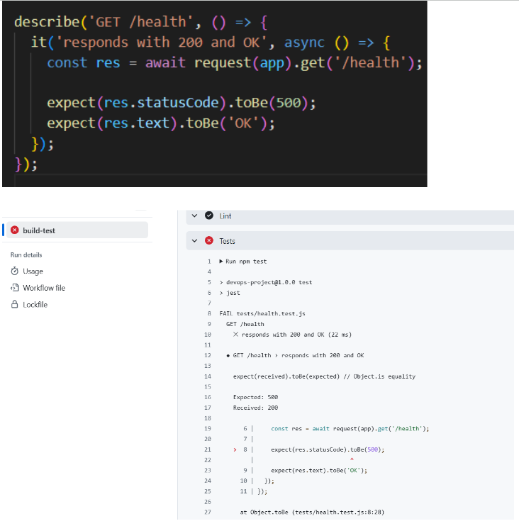
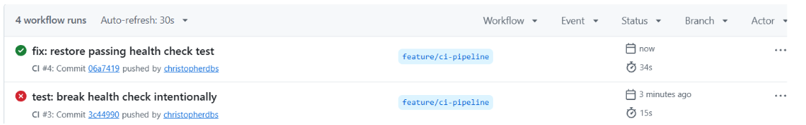

# Lab 1 Answers

GitHub repository: [IvanGrandi/devops-project-26-27](https://github.com/IvanGrandi/devops-project-26-27)

Published image: [ghcr.io/ivangrandi/devops-project-26-27](https://github.com/IvanGrandi/devops-project-26-27/pkgs/container/devops-project-26-27)

Students:

- Ivan Grandi
- Christopher Dubois
- Antoine Cortial

AI tools used: Claude, Gemini and ChatGPT.

We used them to develop a basic version of an API with a health endpoint, check for syntax errors, answer questions about the code we wrote, and get unblocked on some steps.

**Question 1: Why forbid direct pushes to main?**

Forbidding direct pushes to main and requiring Pull Requests ensures the stability and security of the main branch, which should always be ready for production. It allows teammates to review the code and check for bugs or security flaws. It is also a good way to communicate and share knowledge within the team. Finally, it is good practice to require the automated CI tests to pass on a branch before it is merged.

**Question 2: What is the difference between an image and a container?**

An image in Docker is a static, read-only package containing everything needed to run the application, including the code, libraries, environment variables, etc. A container is an isolated running instance of an image.

**Question 3: Compare the size of your image with a non-slim base image. What do you observe?**

We built the same application twice, changing only the base image:

| Base image                   | Disk usage | Content size |
| ---------------------------- | ---------- | ------------ |
| `node:22-alpine`             | 348 MB     | 85.3 MB      |
| `node:22` (non-slim, Debian) | 1.73 GB    | 433 MB       |

The image based on `node:22` is about 5 times bigger than the Alpine one, both on disk and in content size, even though the application code and its dependencies are exactly the same. Almost all of the difference therefore comes from the base image: `node:22` is built on a full Debian distribution that ships compilers and many system libraries, which are not needed to run our API. Alpine is a minimal Linux distribution that only contains the essentials.

**Question 4: Why tag the image with the commit SHA rather than latest?**

This enables better traceability, as it links each deployment to a specific commit, whereas the `latest` tag is mutable and changes over time. This makes it harder to know which version is in production when a bug occurs.

**Question 5: What does "fail fast" mean in a pipeline?**

In a pipeline, "fail fast" means placing the fastest and cheapest steps, such as linting and unit tests, at the beginning so that errors are detected as early as possible. The pipeline stops at the first failure, which saves time, since the longer steps (such as building and publishing the image) only run if everything before them succeeded.

## CI pipeline evidence

**Failing pipeline: test deliberately broken**

**Failing then passing runs**

