# Lab 2 Answers

GitHub repository: [IvanGrandi/devops-project-26-27](https://github.com/IvanGrandi/devops-project-26-27)

Students:

- Ivan Grandi
- Christopher Dubois
- Antoine Cortial

**Question 1: What is the role of a namespace? Does it provide strong security isolation by itself?**

A namespace is a logical partition inside a cluster. It groups different types of resources, such as pods, services and deployments. It does not provide strong security isolation by itself, because pods in different namespaces can still communicate over the network by default, and they share the same nodes and kernel. For real isolation, we would need to add network controls or use separate clusters.

**Question 2: Why does Kubernetes recreate the deleted pod? Which component is responsible?**

Kubernetes works with a desired state given by the developer in the Deployment file. In our case, we declared 3 replicas, which Kubernetes maintains. The ReplicaSet controller constantly compares the desired state with the actual state. When we deleted a pod, it saw only 2 pods instead of 3 and created a new one to match the desired state.

**Question 3: What is the difference between a readiness and a liveness probe? What happens to traffic when readiness fails?**

A readiness probe checks whether a pod is able to receive traffic. If it fails, the pod is removed from the Service endpoints, but it is not restarted. The pod keeps running and is added back automatically when the probe passes again.

A liveness probe checks whether the container is still alive. If it fails several times in a row, Kubernetes kills and restarts the container.

When readiness fails, the Service stops sending requests to that pod, and the traffic goes only to the other Ready pods. If no pod is Ready, the Service has no endpoints and requests fail.

**Question 4: Is a Kubernetes Secret encrypted by default? How would you improve this?**

No. By default, a Kubernetes Secret is only base64-encoded, which is an encoding, not encryption. Anyone who can read the Secret can decode it.

To improve this, we can restrict access to Secrets with RBAC, encrypt them at rest in etcd, use external secret managers such as Vault or a cloud KMS, and, of course, never commit secrets to Git. We can also do what we did in the previous parts: use a ConfigMap to keep non-sensitive settings per environment, so that only sensitive data is stored in Secrets.

**Question 5: How does this pattern help with hybrid/multi-cloud deployments? What would differ between a real on-prem cluster and a cloud cluster?**

The base + overlays pattern separates the common manifests from the settings specific to each environment. For hybrid or multi-cloud deployments, it avoids duplicating code: we write the base once and then add one overlay for each target.

The differences between an on-prem cluster and a cloud cluster are mainly in the storage, the security and the network handling. For example, in the cloud a Service of type LoadBalancer gets a public IP automatically, while on-prem we have to use a NodePort or set up our own load balancer.

**Question 6: Why did the broken rollout not take down the application?**

Because one of the strengths of Kubernetes is its default rolling update strategy combined with pod health checks. The update is progressive: Kubernetes does not remove the old pods first; it first tries to create new pods with the new image. Here the image tag did not exist, so the new pods never became Ready. Since Kubernetes does not remove old pods until the new ones are Ready, it kept routing traffic to the old pods, which were still working. This mechanism prevents downtime, and we could then roll back with kubectl rollout undo.

**Question 7: Starting from a pod running in production, how can you find the commit, the reviewer and the pipeline run that produced it?**

From the pod, we can find the Deployment that owns it with `kubectl get pod <pod-name> -n prod -o jsonpath='{.metadata.ownerReferences}'`. Then we can read the annotations we added to the Deployment in step 6.1 with `kubectl describe deployment myapp -n prod`. The `git-commit` annotation (which is also the tag of the image) gives the commit, and the `pipeline-run` annotation gives the link to the GitHub Actions run that built the image. On GitHub, the commit leads to the Pull Request that merged it, which shows who reviewed and approved it.

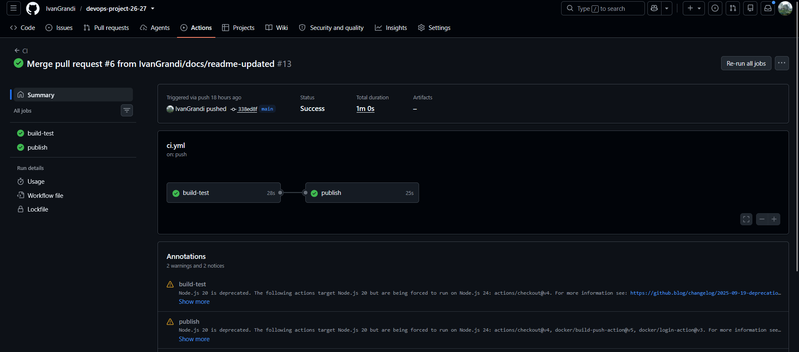

**Question 8: Why is manual `kubectl edit` in production a traceability risk?**

It is a traceability risk because a manual modification made directly on the cluster creates a drift between the Git repository and the live infrastructure. It creates a change that exists only in the cluster and is not recorded in the commit history, in a Pull Request or anywhere else. It is not reviewed and does not go through the CI pipeline, and it becomes impossible to know its author, its date and the reason for the change. Moreover, during the next automated deployment, the manual change will be silently overwritten, which can cause unexpected behavior or conflicts.

## Part 4

**4.1 Base Kustomization**

```yaml
apiVersion: kustomize.config.k8s.io/v1beta1
kind: Kustomization
resources:
  - deployment.yaml
  - service.yaml
```

**Three overlays**

Dev

```yaml
apiVersion: kustomize.config.k8s.io/v1beta1
kind: Kustomization
namespace: dev
resources:
  - ../../base
replicas:
  - name: myapp
    count: 1
commonLabels:
  env: dev
```

Staging

```yaml
apiVersion: kustomize.config.k8s.io/v1beta1
kind: Kustomization
namespace: staging
resources:
  - ../../base
replicas:
  - name: myapp
    count: 2
commonLabels:
  env: staging
```

Prod

```yaml
apiVersion: kustomize.config.k8s.io/v1beta1
kind: Kustomization
namespace: prod
resources:
  - ../../base
replicas:
  - name: myapp
    count: 5
images:
  - name: ghcr.io/ivangrandi/devops-project-26-27
    newTag: "338ed8f64eb5cccdd278ca5b3ef63694c2ee7793"
commonLabels:
  env: prod
```

**4.2**

```text
$ kubectl kustomize k8s/overlays/prod
apiVersion: v1
kind: Service
metadata:
  labels:
    app: myapp
    env: prod
  name: myapp
  namespace: prod
spec:
  ports:
  - port: 80
    targetPort: 3000
  selector:
    app: myapp
    env: prod
  type: ClusterIP
---
apiVersion: apps/v1
kind: Deployment
metadata:
  labels:
    app: myapp
    env: prod
  name: myapp
  namespace: prod
spec:
  replicas: 5
  selector:
    matchLabels:
      app: myapp
      env: prod
  template:
    metadata:
      labels:
        app: myapp
        env: prod
    spec:
      containers:
      - env:
        - name: APP_ENV
          valueFrom:
            configMapKeyRef:
              key: APP_ENV
              name: myapp-config
        - name: API_KEY
          valueFrom:
            secretKeyRef:
              key: API_KEY
              name: myapp-secret
        image: ghcr.io/ivangrandi/devops-project-26-27:338ed8f64eb5cccdd278ca5b3ef63694c2ee7793
        livenessProbe:
          httpGet:
            path: /health
            port: 3000
          initialDelaySeconds: 10
        name: myapp
        ports:
        - containerPort: 3000
        readinessProbe:
          httpGet:
            path: /health
            port: 3000
          initialDelaySeconds: 5
          periodSeconds: 5
        resources:
          limits:
            cpu: 500m
            memory: 256Mi
          requests:
            cpu: 100m
            memory: 128Mi
      imagePullSecrets:
      - name: ghcr-secret
```

**4.3**

We deploy each overlay to its namespace:

```text
$ kubectl apply -k k8s/overlays/dev
$ kubectl apply -k k8s/overlays/staging
$ kubectl apply -k k8s/overlays/prod
```

**4.4**

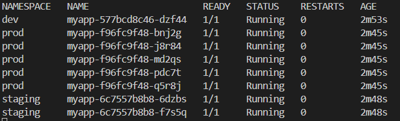

`kubectl get all` in each namespace:

```text
$ kubectl get all -n dev
NAME                         READY   STATUS    RESTARTS   AGE
pod/myapp-577bcd8c46-dzf44   1/1     Running   0          58m

NAME            TYPE        CLUSTER-IP      EXTERNAL-IP   PORT(S)   AGE
service/myapp   ClusterIP   10.96.205.135   <none>        80/TCP    18h

NAME                    READY   UP-TO-DATE   AVAILABLE   AGE
deployment.apps/myapp   1/1     1            1           58m

NAME                               DESIRED   CURRENT   READY   AGE
replicaset.apps/myapp-577bcd8c46   1         1         1       58m
```

```text
$ kubectl get all -n staging
NAME                         READY   STATUS    RESTARTS   AGE
pod/myapp-6c7557b8b8-6dzbs   1/1     Running   0          58m
pod/myapp-6c7557b8b8-f7s5q   1/1     Running   0          58m

NAME            TYPE        CLUSTER-IP   EXTERNAL-IP   PORT(S)   AGE
service/myapp   ClusterIP   10.96.58.3   <none>        80/TCP    58m

NAME                    READY   UP-TO-DATE   AVAILABLE   AGE
deployment.apps/myapp   2/2     2            2           58m

NAME                               DESIRED   CURRENT   READY   AGE
replicaset.apps/myapp-6c7557b8b8   2         2         2       58m
```

```text
$ kubectl get all -n prod
NAME                        READY   STATUS    RESTARTS   AGE
pod/myapp-f96fc9f48-bnj2g   1/1     Running   0          58m
pod/myapp-f96fc9f48-j8r84   1/1     Running   0          58m
pod/myapp-f96fc9f48-md2qs   1/1     Running   0          58m
pod/myapp-f96fc9f48-pdc7t   1/1     Running   0          58m
pod/myapp-f96fc9f48-q5r8j   1/1     Running   0          58m

NAME            TYPE        CLUSTER-IP     EXTERNAL-IP   PORT(S)   AGE
service/myapp   ClusterIP   10.96.209.27   <none>        80/TCP    58m

NAME                    READY   UP-TO-DATE   AVAILABLE   AGE
deployment.apps/myapp   5/5     5            5           58m

NAME                              DESIRED   CURRENT   READY   AGE
replicaset.apps/myapp-f96fc9f48   5         5         5       58m
```

## Part 5

**5.1** We added this newTag in the kustomization.yaml file in the dev folder. It is a newer image built by our CI pipeline.

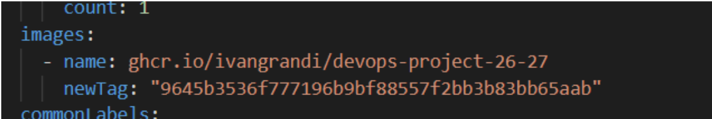

We apply the modification.

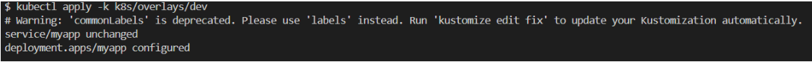

**5.2** We watch the rollout status and we can see that everything is successful.


**5.3** We put a tag that does not exist.

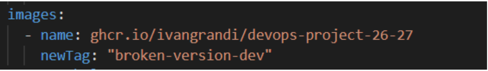

We apply it, and the rollout does not finish.

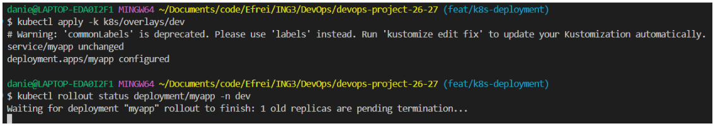

In the events, we can see that the image cannot be pulled.

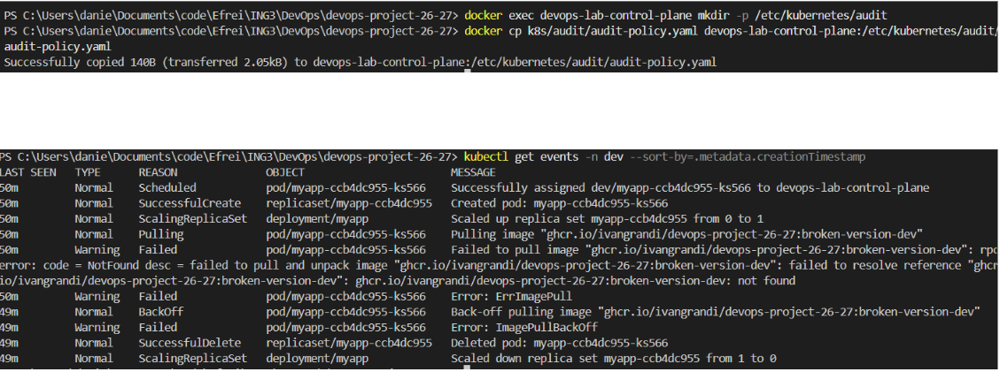

**5.4**

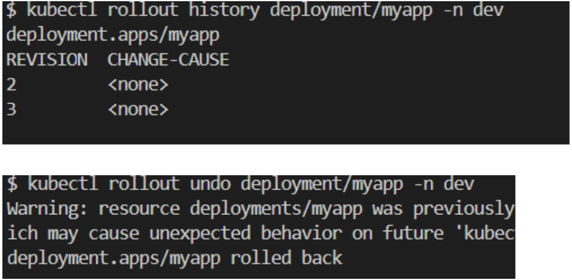

The app is now working again and the pods are stable.

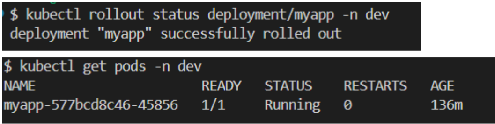

## Part 6

**6.1** We annotated the deployment.

```text
$ kubectl annotate deployment myapp -n prod git-commit="338ed8f64eb5cccdd278ca5b3ef63694c2ee7793" pipeline-run="https://github.com/IvanGrandi/devops-project-26-27/actions/runs/44097382798" owner="team-devops" ticket="OPS-123"
deployment.apps/myapp annotated
```

We can check the annotations like this:

```text
$ kubectl describe deployment myapp -n prod
Name:                   myapp
Namespace:              prod
Labels:                 app=myapp
                        env=prod
Annotations:            deployment.kubernetes.io/revision: 1
                        git-commit: 338ed8f64eb5cccdd278ca5b3ef63694c2ee7793
                        owner: team-devops
                        pipeline-run: https://github.com/IvanGrandi/devops-project-26-27/actions/runs/44097382798
                        ticket: OPS-123
```

**6.2**

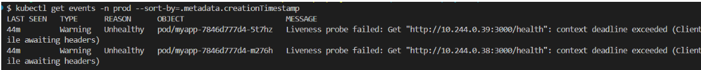

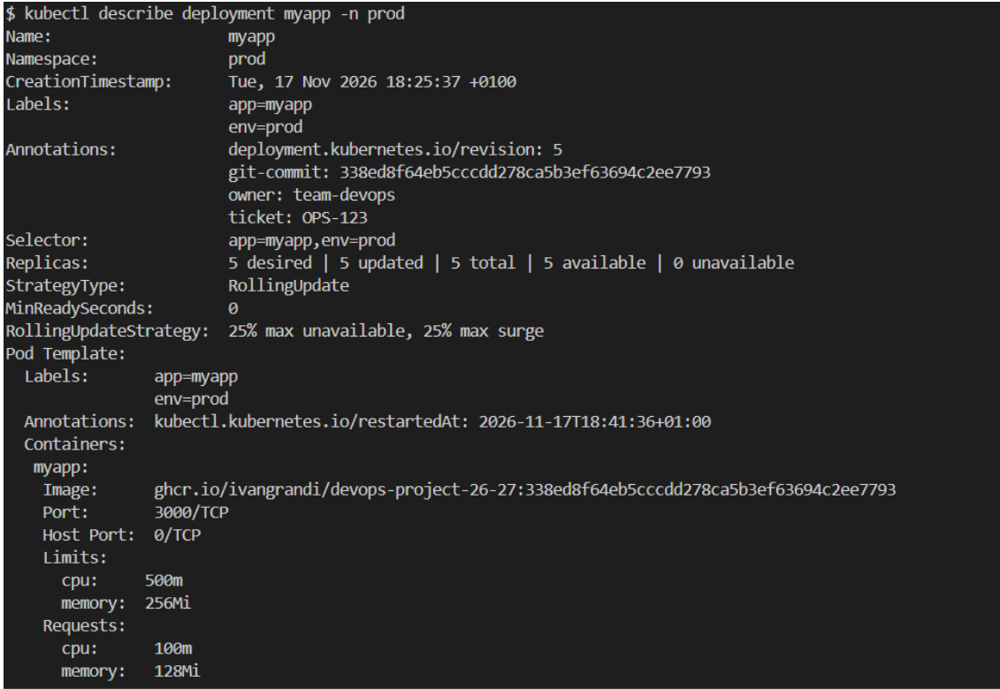

**6.3**

First, we create the service account.

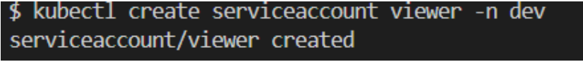

Then we create a role allowing read-only access to pods.

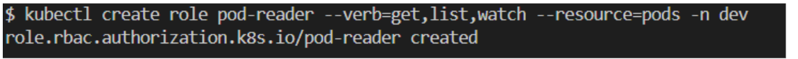

We bind the role to the service account.

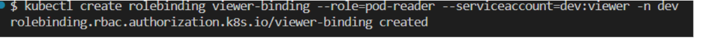

Here we test the RBAC permissions assigned to our viewer: first to delete pods, and then to list pods. As we only gave the role the get, list and watch verbs, the answer is no for delete and yes for list.

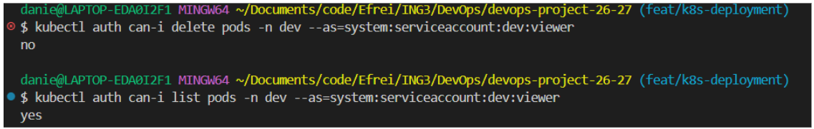

The RBAC manifests (ServiceAccount, Role and RoleBinding) are in `k8s/rbac/viewer-rbac.yaml`. We applied the file and got the same results:

```text
$ kubectl apply -f k8s/rbac/viewer-rbac.yaml
serviceaccount/viewer created
role.rbac.authorization.k8s.io/pod-reader created
rolebinding.rbac.authorization.k8s.io/viewer-binding created
$ kubectl auth can-i delete pods -n dev --as=system:serviceaccount:dev:viewer
no
$ kubectl auth can-i list pods -n dev --as=system:serviceaccount:dev:viewer
yes
```

**6.4 (Bonus)**

First, we create an audit policy file.

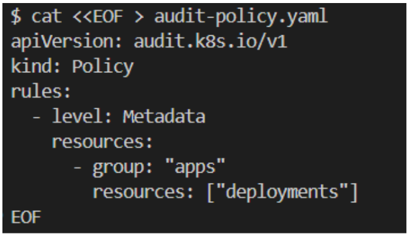


