# Lab 3 Answers

GitHub repository: [IvanGrandi/devops-project-26-27](https://github.com/IvanGrandi/devops-project-26-27)

Students:

- Ivan Grandi
- Christopher Dubois
- Antoine Cortial

**Question 1: What did Terraform propose after you deleted the container by hand? What is this situation called?**

Terraform proposed to recreate the container after I deleted it. When using terraform plan, Terraform contacts Docker to see if the web container exists. Docker in this case answered that it did not exist. As the main.tf explicitly stated that such a container should exist, Terraform proposed to recreate it.

This situation is called drift: the real infrastructure no longer matches what Terraform manages, because someone changed it outside Terraform.

**Question 2: Why should the state file never be committed to Git?**

The state should never be pushed to Git because it is a file that changes constantly. It is a memory file that corresponds to the last infrastructure that was created, and it can be outdated.

We also don't push it for security reasons. The state stores every attribute of every resource in plain text, such as passwords, tokens and keys, and anything pushed to Git stays in the history.

It can also cause teamwork problems. If two people create different resources and push their own state, Terraform may lose track of some of them. For example, if person A creates web + api and pushes the state, and then person B creates web + db and also pushes the state, Terraform will only know the last version of the infrastructure. In this case, it will ignore the api created by person A, which becomes an orphan.

**Question 3: What are the advantages of one folder and one state per environment compared to workspaces?**

In general, it ensures several things. First, isolation: we can create different environments, such as dev and staging, without them affecting each other. If one of the environments is corrupted or has mistakes, it won't affect the others.

Also, with one folder per environment, each environment has its own variables file (for example with different ports) in its own folder, and the environment is visible in the path of the command. With workspaces, all environments share the same folder and we switch between them with a command, so it is easy to forget which workspace is selected and use the wrong variables or apply on the wrong environment by mistake.

Finally, it ensures that each file has its own responsibility. This improves readability and scalability if, in the future, a developer needs to understand the code and add new features or configurations.

**Question 4: Why is a remote backend with locking essential for a team? Which problems does it prevent?**

A remote backend with locking is essential for a team to prevent people from overwriting each other's state. It allows everyone to use the same, up-to-date version of the state, so that nobody runs Terraform on an old version. The lock is essential to prevent the case where two people want to apply their Terraform configuration at the same time. The lock puts a flag on the state so that the applies run one after the other.

Without it, we could have resources that Terraform forgets (orphans) or creates twice, or even a corrupted state file.

**Question 5: What information in a state file can be sensitive?**

The state file contains the secrets used by the resources, such as database passwords, API keys, tokens or private keys. They are written explicitly in plain text, even if the variable is marked as sensitive in Terraform. The state also contains information about the infrastructure, such as IP addresses, ports, resource IDs or account IDs. This information can help an attacker understand our infrastructure.

**Question 6: What could go wrong if the preview environment is never destroyed? List three mitigations.**

If the preview environment is never destroyed, it keeps using resources like CPU and memory for nothing. With time, forgotten namespaces accumulate, which makes the cluster harder to manage and can make it run out of capacity. They also run old versions of the code that nobody updates, so they can contain security vulnerabilities.

Three mitigations:

- Destroy the preview automatically in the CI when the Pull Request is closed or merged.
- Add the labels owner and expires to the namespace and run a scheduled job that deletes the namespaces whose expiration date has passed.
- Set resource quotas on the preview namespaces and monitor the costs, so a forgotten environment cannot use too many resources.

**Question 7: Why run plan on a Pull Request but apply only after merge?**

The plan only shows what Terraform would change without touching the infrastructure, so it is safe to run on a Pull Request. The reviewers can read the plan and check the changes before approving. The apply really modifies the infrastructure, so it must only run after the code has been reviewed and merged into main. If we don't do that, any Pull Request, even one with mistakes or one that is never accepted, could change or destroy real resources. Also, if several Pull Requests applied at the same time, the infrastructure would not match the code in main anymore.

**Question 8: Why should a CI pipeline use short-lived credentials (OIDC) rather than long-lived access keys?**

A long-lived access key is stored as a secret in the CI and stays valid for months or until someone deletes it. If it leaks, an attacker can use it for a long time. With OIDC, the CI asks the cloud provider for a temporary token at each run. The token expires after a few minutes and can be limited to one repository or one branch. There is no secret to store or rotate. A leaked token becomes useless very quickly.

## Part 3

**3.5 Drift detection**

We recreated the dev container by hand with Docker, on another port, and ran terraform plan:

```text
$ docker rm -f tf-web-dev
$ docker run -d --name tf-web-dev -p 8090:80 nginx:1.27
$ terraform -chdir=infra/envs/dev plan "-var-file=dev.tfvars"
module.webapp.docker_image.nginx: Refreshing state... [id=sha256:6784fb0834aa7dbbe12e3d7471e69c290df3e6ba810dc38b34ae33d3c1c05f7dnginx:1.27]
module.webapp.docker_container.web: Refreshing state... [id=b4906c34d577a4abdb007077bfdc0f61f7da5a9826aec7c5e2475bb5a1b53243]

Terraform used the selected providers to generate the following execution plan. Resource actions are indicated with the following symbols:
  + create

Terraform will perform the following actions:

  # module.webapp.docker_container.web will be created
  + resource "docker_container" "web" {
      + attach                                      = false
      + bridge                                      = (known after apply)
      + command                                     = (known after apply)
      + container_logs                              = (known after apply)
      + container_read_refresh_timeout_milliseconds = 15000
      + entrypoint                                  = (known after apply)
      + env                                         = (known after apply)
      + exit_code                                   = (known after apply)
      + hostname                                    = (known after apply)
      + id                                          = (known after apply)
      + image                                       = "sha256:6784fb0834aa7dbbe12e3d7471e69c290df3e6ba810dc38b34ae33d3c1c05f7d"
      + init                                        = (known after apply)
      + ipc_mode                                    = (known after apply)
      + log_driver                                  = (known after apply)
      + logs                                        = false
      + memory_reservation                          = 0
      + must_run                                    = true
      + name                                        = "tf-web-dev"
      + network_data                                = (known after apply)
      + network_mode                                = "bridge"
      + read_only                                   = false
      + remove_volumes                              = true
      + restart                                     = "no"
      + rm                                          = false
      + runtime                                     = (known after apply)
      + security_opts                               = (known after apply)
      + shm_size                                    = (known after apply)
      + start                                       = true
      + stdin_open                                  = false
      + stop_signal                                 = (known after apply)
      + stop_timeout                                = (known after apply)
      + tty                                         = false
      + wait                                        = false
      + wait_timeout                                = 60

      + healthcheck (known after apply)

      + labels (known after apply)

      + ports {
          + external = 8083
          + internal = 80
          + ip       = "0.0.0.0"
          + protocol = "tcp"
        }
    }

Plan: 1 to add, 0 to change, 0 to destroy.
```

Terraform looks for the container ID saved in the state (b4906c34d577...). This container does not exist anymore, so Terraform does not recognize the one we created by hand, even with the same name, and proposes to create its container again on port 8083.

## Part 4

**4.1** We added a Service exposing the deployment:

```hcl
resource "kubernetes_service" "preview_service" {
  metadata {
    name      = "myapp-svc"
    namespace = kubernetes_namespace.preview.metadata[0].name
  }
  spec {
    selector = {
      app = "myapp"
    }
    port {
      port        = 80
      target_port = 3000
    }
    type = "ClusterIP"
  }
}
```

**4.2**

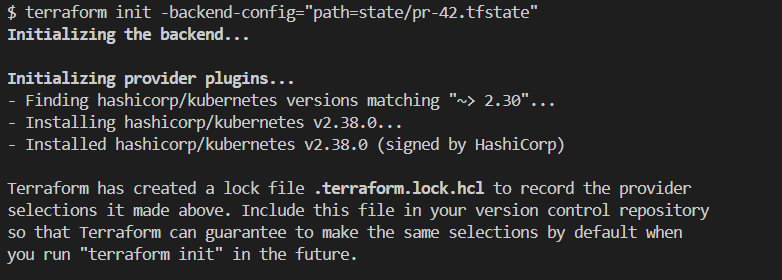
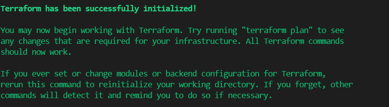
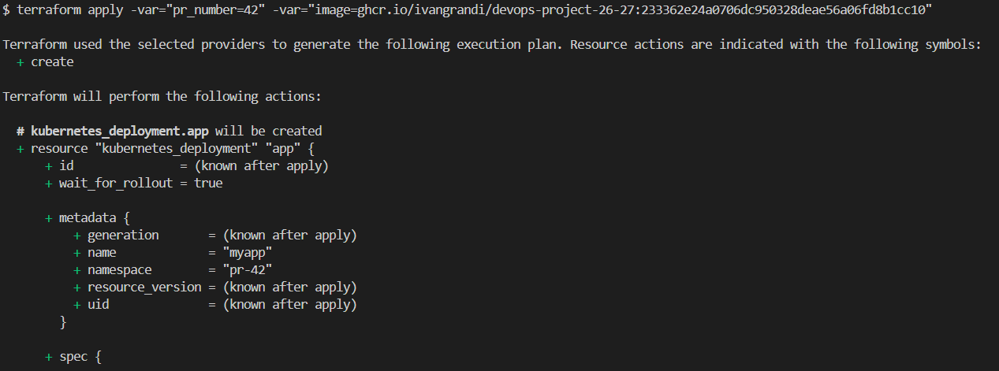
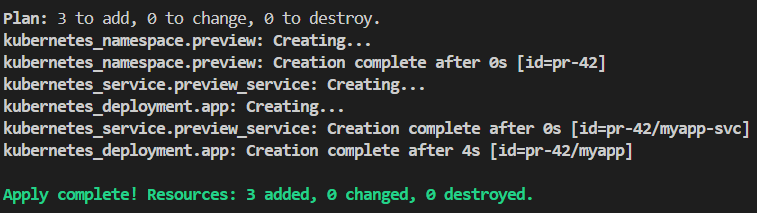
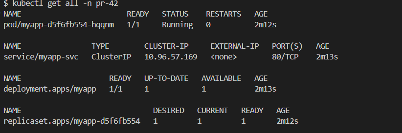

**4.3**

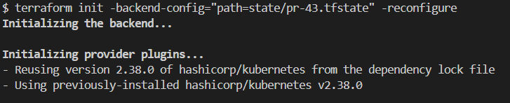
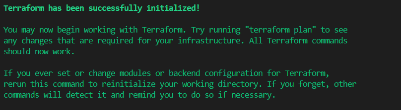
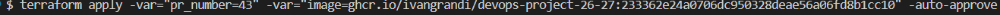
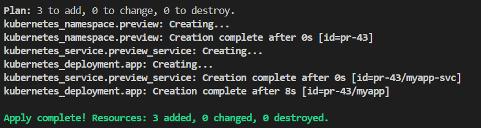
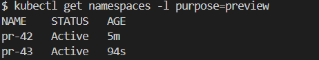

**4.4** We change to the right state (42) and then launch the destroy command.

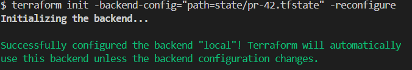
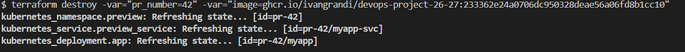
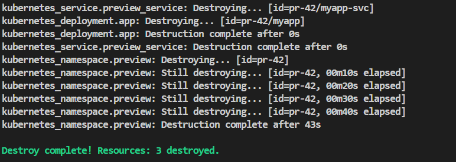
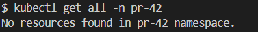
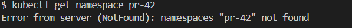
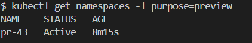

**4.5**

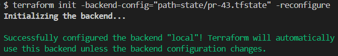
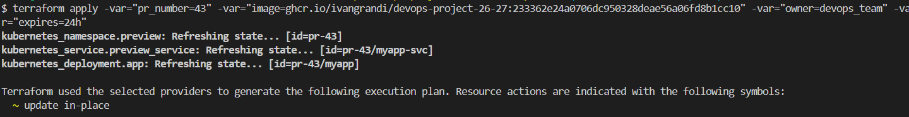
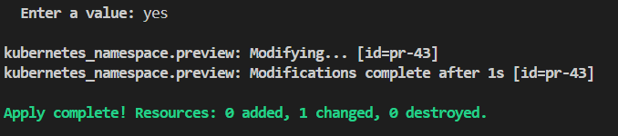
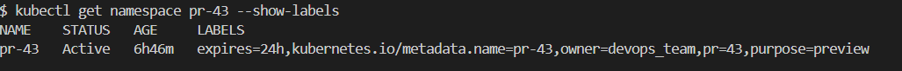

## Part 5

**5.1 to 5.4** The workflow is in .github/workflows/terraform.yml. It runs only on Pull Requests that modify files in the infra/ folder. It runs terraform fmt -check and terraform validate, runs terraform plan for dev and staging and uploads the output as an artifact, and runs a Checkov security scan that fails on high severity checks. It never runs apply.

**5.5** We added privileged = true to the preview container. The security scan failed the pipeline:

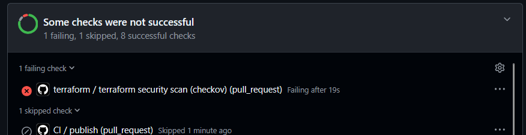
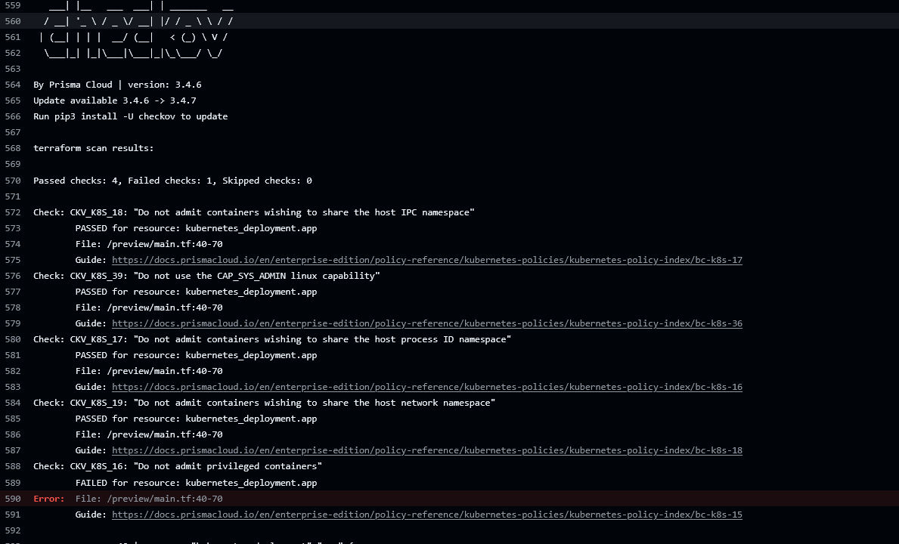

**5.6** We removed it and the pipeline passes:

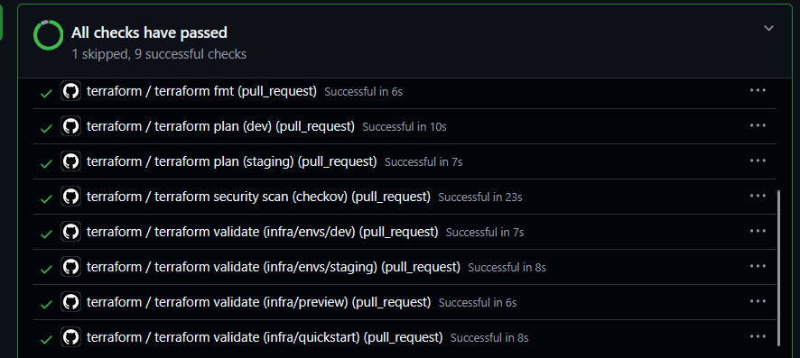
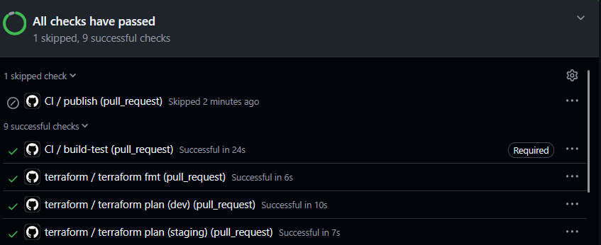
