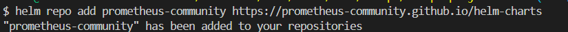
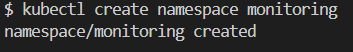
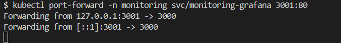
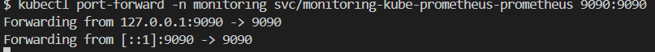
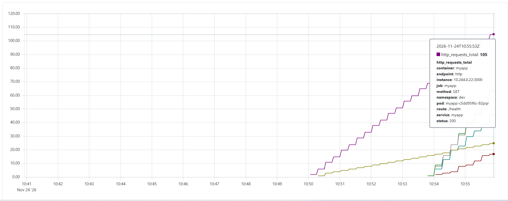
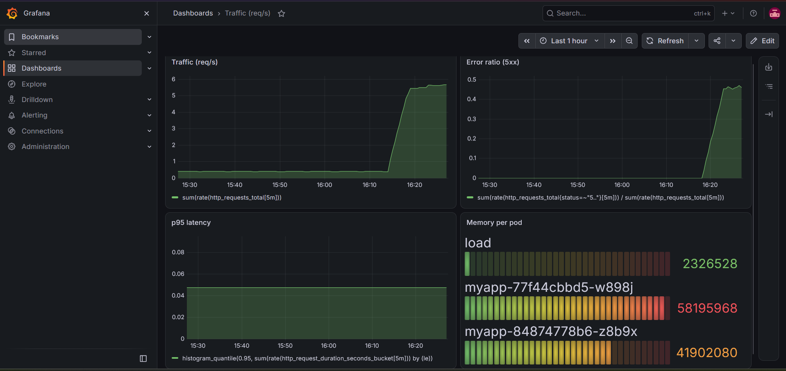
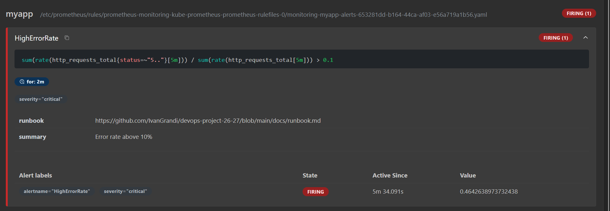

## Part 1

**Question 1: Why is it a problem to use a user ID or a full URL containing IDs as a metric label?**

It is a problem to use IDs and full URLs as labels because they generate an unlimited number of time series. Prometheus groups the requests by their labels and increases the count of the matching time series. For example, if someone calls the /health endpoint, the app saves the method, the route and the status. This allows grouping all the calls to that endpoint and counting how many times it was called. However, with a unique ID or URL, we would not be able to group the requests, and we would have a huge number of time series with a count of 1. Each time series is stored in memory, so Prometheus would use more and more memory, the queries would become slow and it could even crash. This would also give bad statistics about the endpoints requested in our app. It is better to use labels with a limited number of values, like the method, the route or the status.

**Question 2: Why log to stdout in JSON rather than to a file in plain text?**

It is better to log in JSON because it works with keys and values, which allows a tool to quickly find and filter the values it needs (for example, all the logs with status 500). Moreover, saving the logs into a file has many problems. First, the number of lines in the file increases indefinitely over time. Also, the file is inside the container, so it is deleted when Kubernetes restarts the pod. Lastly, as our infrastructure has multiple pods, each pod would have its own log file, and to get the global logs we would have to read each one of them. With stdout, Kubernetes collects the logs of all the pods automatically, so we can read them with kubectl logs or send them to a central log tool.

## Part 2

First, we installed the kube-prometheus-stack Helm chart:






Now all the new pods are running. We can port-forward Grafana and Prometheus to access their interfaces directly through our web browser.





**2.1** We retrieve the Grafana admin password from the Kubernetes secret (the password is hidden in the screenshot):


**2.2** Then we open Grafana and display the pre-installed Kubernetes dashboards.


**2.3** We also open the Prometheus UI and check the Targets page.


## Part 3

**3.1** We created a servicemonitor.yaml file with the ServiceMonitor. With this configuration, Prometheus can discover the application.

```yaml
apiVersion: monitoring.coreos.com/v1
kind: ServiceMonitor
metadata:
  name: myapp
  namespace: monitoring
  labels:
    release: monitoring
spec:
  namespaceSelector:
    matchNames: ["dev"]
  selector:
    matchLabels:
      app: myapp
  endpoints:
    - port: http
      path: /metrics
      interval: 15s
```

We adjusted the Service by adding http as the name of the port.


We use the apply command to update the configuration of the Service.


We check that the command displays http.


Then we apply the ServiceMonitor.


**3.2** We check that myapp appears:


We can see that it is UP in Prometheus:


**3.3** We generated traffic and queried http_requests_total in the Prometheus UI. Here is our result:




**Question 3: The target does not appear. List three things you would check.**

If the target doesn't appear, we would check:

- The labels of the ServiceMonitor in metadata.labels, to check that the key/value pairs required by Prometheus (release: monitoring) are present, so that it can select the ServiceMonitor resource.
- The matchLabels and the namespaceSelector, to see if they match the labels and the namespace of the target Service.
- The name of the port in both the Service and the ServiceMonitor, to check that they match.

## Part 4

4.1 These are the PromQL queries for each golden signal and their results when executing each in Query tab in Prometheus:

# Traffic

sum(rate(http_requests_total[5m]))
Result: 0.3684236380606179

# Error ratio

sum(rate(http_requests_total{status=~"5.."}[5m])) / sum(rate(http_requests_total[5m]))
Results: Empty results - This query returned no data

# p95 latency

histogram_quantile(0.95,
sum(rate(http_request_duration_seconds_bucket[5m])) by (le))
Results: 0.9850000000000001

# Memory per pod

sum(container_memory_working_set_bytes{namespace="dev"}) by (pod)
Results: 52154368 (pod="myapp-c5dd95f6c-82pqr")

**Question 4: Why is the 95th percentile more informative than the average latency?**

It is more informative because it captures the tail behavior and it is less distorted by outliers. Indeed, a small number of very slow requests can pull the average up or down. For latency, this percentile means that 95% of the requests complete at or below that duration, which gives a clearer view of the real user latency than a single average.

## Part 5

**Question 5: What is alert fatigue and how do the for: clause and severity labels help?**

Alert fatigue is when the team receives too many alerts or messages and most of them are not important or are false alarms. Because of the huge number of messages, people stop paying attention and start ignoring them. So when a real problem happens, the alert can be missed or treated too late.

The for: clause helps with that problem because it creates a condition that must stay true for a certain time before the alert fires. For example, with for: 2m, the error rate must stay above 10% for 2 minutes. A short spike of errors for a few seconds does not send an alert, only a problem that lasts.

On the other hand, the severity labels help to know how urgent an alert is. Alertmanager can use them to route the alerts. For example, a critical alert is highlighted right away, while a warning can just create a ticket to look at later. This way, people are only notified for real problems.

## Part 6

**6.1** We deployed a bugged version of the application in the dev namespace. Its root endpoint "/" returns a 500 error for about half of the requests, while /health keeps working. The image was built locally and deployed without going through the CI pipeline:

```bash
kubectl set image deployment/myapp myapp=ghcr.io/ivangrandi/devops-project-26-27:v2 -n dev
```

**6.2** The error ratio on the dashboard goes from 0 to about 0.46, while the traffic stays stable and the p95 latency stays flat:



The HighErrorRate alert goes to Firing:



We identified the faulty deployment with `kubectl rollout history`, the image of the deployment (tagged `v2` instead of a commit SHA) and `kubectl logs` (500 errors on the root endpoint "/"). Then we mitigated first with a rollback:

```bash
kubectl rollout undo deployment/myapp -n dev
```

After the rollback, the error ratio goes back to 0 and the alert goes back to Inactive:


**6.3 and 6.4** The timeline of events (UTC) and the blameless postmortem are in [docs/postmortem.md](docs/postmortem.md).

**Question 6: Why mitigate before finding the root cause?**

Mitigation consists of applying a temporary solution. It may not be optimal in the long term, but it keeps the app working while the root cause is analysed. It is a strategy to buy some time, as the analysis can take hours or days before a proper fix is implemented. Every minute of downtime makes the user base decrease and the company lose money. Mitigation is usually done first, and we look for the root cause after the service is working again.

In our incident, the rollback took about 15 seconds and the errors stopped right away. Finding the root cause of why the new version was failing would have taken much longer, and users would have kept getting errors during all that time. That is why mitigating first is important. We do not lose information, as the bugged image and the logs are still available to find the root cause afterwards.

**Question 7: Why must a postmortem be blameless? Give an example of a blameless rewording of "Alex deployed a bad version".**

Blaming people is a bad practice. We don't want people to be scared to take responsibility for their actions and to try to hide their mistakes. If people are afraid of being blamed, they don't share all the information, and the team cannot understand what really happened. The goal of the postmortem is to fix the process that led to the situation, not to punish someone.

For example, instead of saying "Alex deployed a bad version", we can write: "A version that was not tested by the CI pipeline was deployed to production. It caused an issue because nothing in our process prevents a manual deployment without tests."

**Question 8: Propose two concrete changes to the pipeline from Sessions 1 to 3 that would have prevented or limited this incident (for example, canary release or smoke tests).**

We could have added smoke tests after deploying. For this, the pipeline calls the main routes of the application (like the root endpoint "/") several times and checks that they return 200. If they fail, the pipeline runs kubectl rollout undo automatically. In our incident, /health still worked, so the Kubernetes probes did not see the problem, but a smoke test on "/" would have detected it in a few seconds.

We could also have done a canary release. Instead of replacing all the pods at once, the new version first receives a small part of the traffic, for example 10%. Then, we check the error ratio in Prometheus, and if it goes above 10%, the deployment stops and goes back to the previous version. This would have limited the impact to a small part of the users instead of all of them.
