## Part 2

First, we installed the kube-prometheus-stack Helm chart:


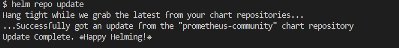

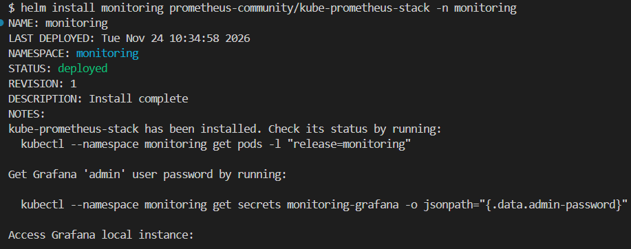

Now all the new pods are running. We can port-forward Grafana and Prometheus to access their interfaces directly through our web browser.

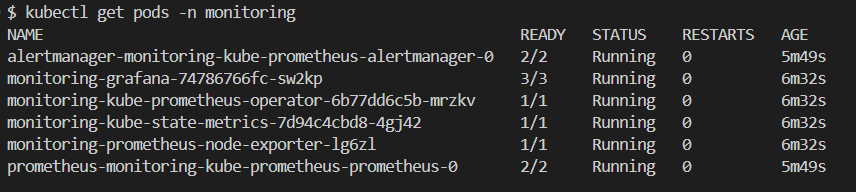


**2.1** We retrieve the Grafana admin password from the Kubernetes secret (the password is hidden in the screenshot):

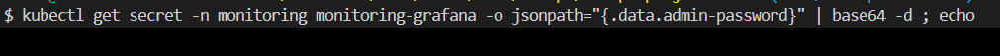

**2.2** Then we open Grafana and display the pre-installed Kubernetes dashboards.

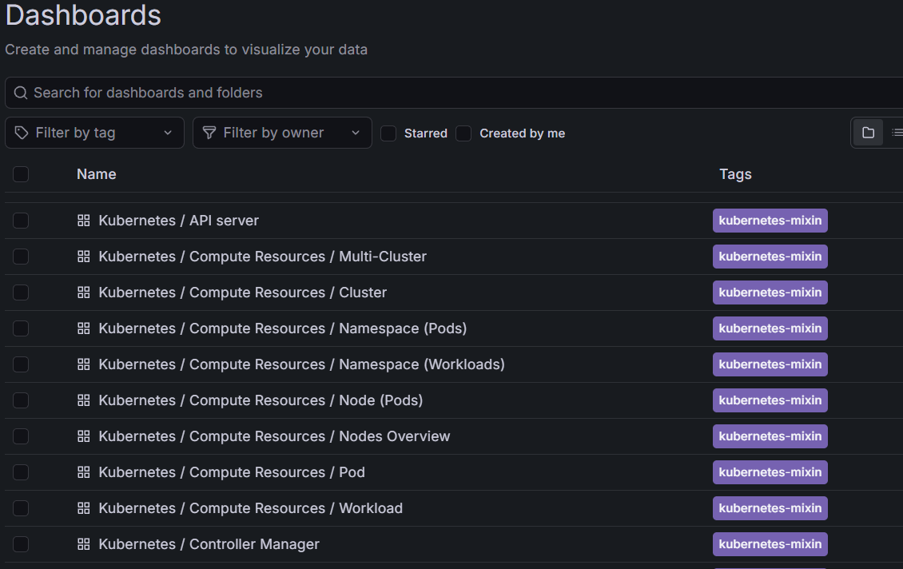

**2.3** We also open the Prometheus UI and check the Targets page.

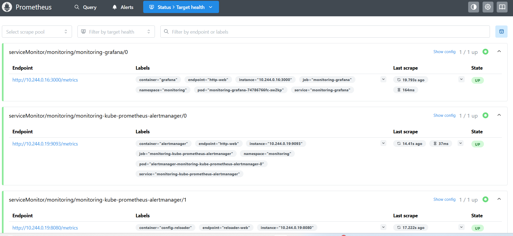

## Part 3

**3.1** We created a servicemonitor.yaml file with the ServiceMonitor. With this configuration, Prometheus can discover the application.

```yaml
apiVersion: monitoring.coreos.com/v1
kind: ServiceMonitor
metadata:
  name: myapp
  namespace: monitoring
  labels:
    release: monitoring
spec:
  namespaceSelector:
    matchNames: ["dev"]
  selector:
    matchLabels:
      app: myapp
  endpoints:
    - port: http
      path: /metrics
      interval: 15s
```

We adjusted the Service by adding http as the name of the port.

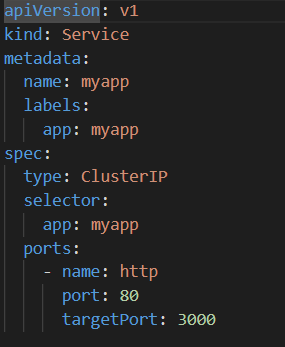

We use the apply command to update the configuration of the Service.

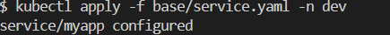

We check that the command displays http.

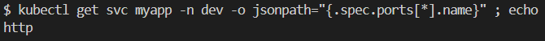

Then we apply the ServiceMonitor.

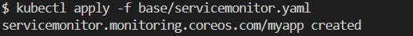

**3.2** We check that myapp appears:

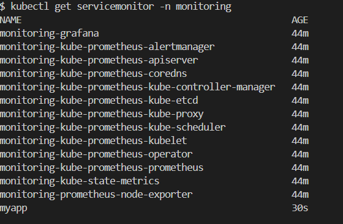

We can see that it is UP in Prometheus:

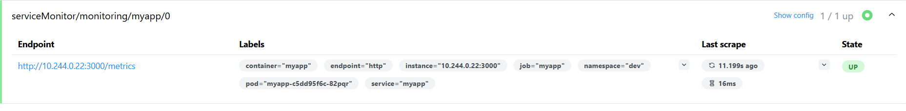

**3.3** We generated traffic and queried http_requests_total in the Prometheus UI. Here is our result:

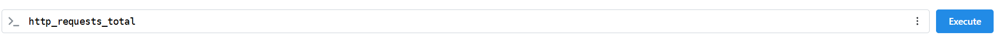
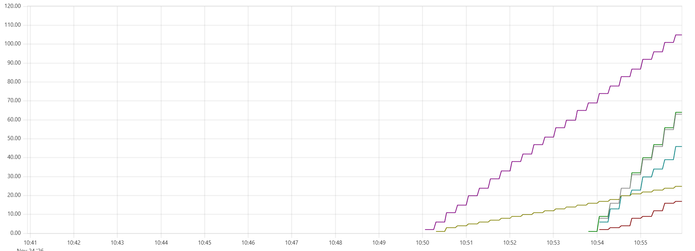


**Question 3: The target does not appear. List three things you would check.**

If the target doesn't appear, we would check:

- The labels of the ServiceMonitor in metadata.labels, to check that the key/value pairs required by Prometheus (release: monitoring) are present, so that it can select the ServiceMonitor resource.
- The matchLabels and the namespaceSelector, to see if they match the labels and the namespace of the target Service.
- The name of the port in both the Service and the ServiceMonitor, to check that they match.

## Part 4

4.1 These are the PromQL queries for each golden signal and their results when executing each in Query tab in Prometheus:

# Traffic

sum(rate(http_requests_total[5m]))
Result: 0.3684236380606179

# Error ratio

sum(rate(http_requests_total{status=~"5.."}[5m])) / sum(rate(http_requests_total[5m]))
Results: Empty results - This query returned no data

# p95 latency

histogram_quantile(0.95,
sum(rate(http_request_duration_seconds_bucket[5m])) by (le))
Results: 0.9850000000000001

# Memory per pod

sum(container_memory_working_set_bytes{namespace="dev"}) by (pod)
Results: 52154368 (pod="myapp-c5dd95f6c-82pqr")

Question 4. Why is the 95th percentile more informative than the average latency?

It is more important informative because it captures tail behavior and it is less distorted by outliers. Indeed a small number of very slow requests can pull the average up or down. Fot latency, this percentile means that 95% of the requests complete at or below that duration which gives a clearer view or real user latency than single average.

## Part 6

**6.1** We deployed a bugged version of the application in the dev namespace. Its root endpoint "/" returns a 500 error for about half of the requests, while /health keeps working. The image was built locally and deployed without going through the CI pipeline:

```bash
kubectl set image deployment/myapp myapp=ghcr.io/ivangrandi/devops-project-26-27:v2 -n dev
```

**6.2** The error ratio on the dashboard goes from 0 to about 0.46, while the traffic stays stable and the p95 latency stays flat:


The HighErrorRate alert goes to Firing:


We identified the faulty deployment with `kubectl rollout history`, the image of the deployment (tagged `v2` instead of a commit SHA) and `kubectl logs` (500 errors on the root endpoint "/"). Then we mitigated first with a rollback:

```bash
kubectl rollout undo deployment/myapp -n dev
```

After the rollback, the error ratio goes back to 0 and the alert goes back to Inactive:

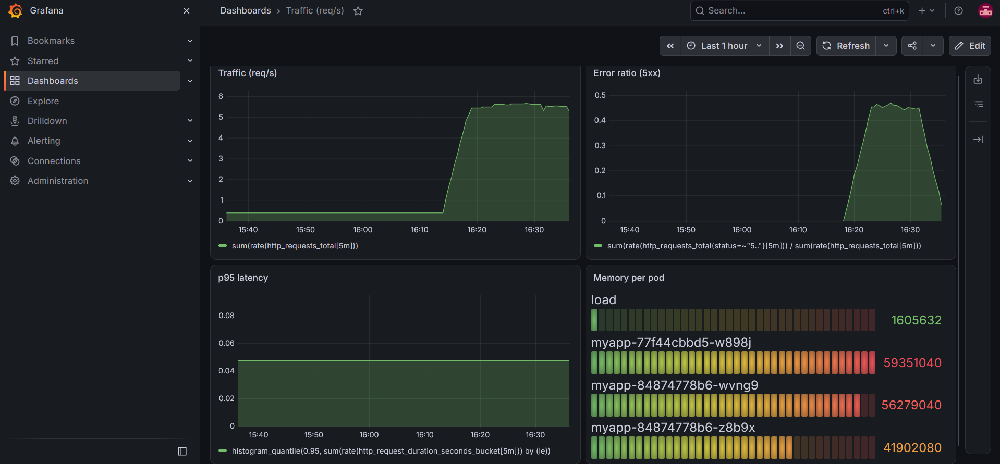
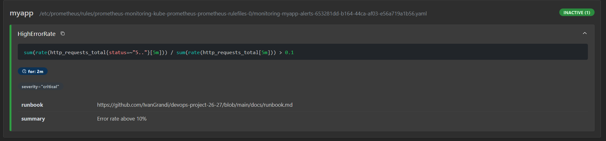

**6.3 and 6.4** The timeline of events (UTC) and the blameless postmortem are in [docs/postmortem.md](docs/postmortem.md).
